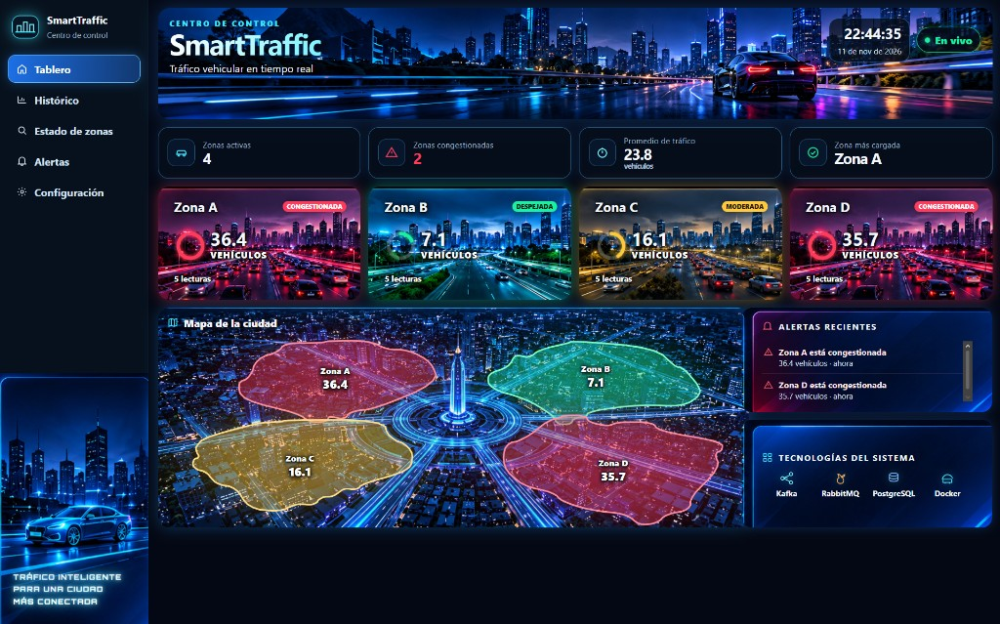
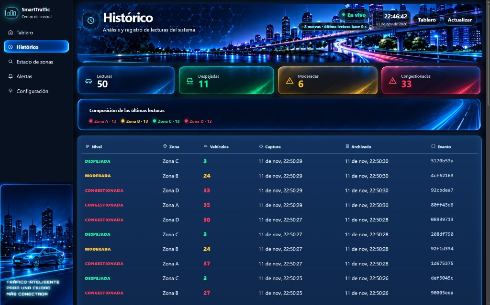
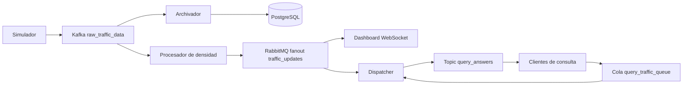

# SmartTraffic

[](https://github.com/vxillaxl/ProyectoFinal/actions/workflows/ci.yml)

Monitoreo de tráfico vehicular en tiempo real. Sensores publican conteos por zona, un procesador calcula la densidad y el nivel de congestión, y el resultado se muestra en un tablero, se guarda en PostgreSQL y responde consultas de trayecto.

El dominio no depende de Spring, Kafka, RabbitMQ ni JPA. Esos frameworks viven en los adaptadores.

## Demo

El tablero pinta las cuatro zonas, el mapa y las alertas según el estado en vivo.



El histórico guarda cada lectura. En cada actualización llegan las cuatro zonas.



## Arquitectura



## Componentes

| Pieza | Entrada | Salida | Responsabilidad |
| --- | --- | --- | --- |
| `traffic_sensor_simulator` | Reloj. Cada zona sortea un régimen y lo mantiene entre 20 y 60 segundos | Topic `raw_traffic_data`, clave = zona | Publica un conteo aleatorio de ese régimen cada 2 segundos |
| `traffic_density_processor` | Ese topic, grupo propio | Exchange fanout `traffic_updates` | Ventana de 5 lecturas y estado por zona |
| `traffic_archiver` | El mismo topic, otro grupo | Tabla `traffic_readings_history` | Guarda cada lectura en su propia transacción, sin repetir `event_id` |
| `user_dashboard_backend` | Cola del fanout | WebSocket `/ws/traffic` | Traduce el estado a un DTO y lo pinta en `dashboard.html` |
| `alert_dispatcher` | Fanout y cola `query_traffic_queue` | Logs de alerta y exchange `query_answers` | Avisa si sube la congestión y responde trayectos |
| `query_client` | Reloj | Work queue de consultas | Pregunta cada 15 segundos y espera su respuesta |
| `dashboard.html` | WebSocket | Pantalla | Muestra zonas, mapa y alertas en vivo |

Los módulos de Maven llevan guion (`traffic-sensor-simulator`). Los contenedores de Docker llevan guion bajo (`traffic_sensor_simulator`).

## Por qué Kafka y por qué RabbitMQ

Kafka es el log. El topic `raw_traffic_data` queda ordenado y particionado por zona, así el procesador y el archivador leen lo mismo con grupos distintos y pueden retomar desde su offset.

RabbitMQ reparte el estado ya calculado. El fanout `traffic_updates` entrega una copia al dashboard y otra al dispatcher. Las consultas entran por la work queue `query_traffic_queue` con prefetch 1, y la respuesta vuelve por el topic exchange `query_answers` con la routing key `answer.<user_id>`.

## Patrones

- **Strategy:** `DensityStrategy`. El promedio puede ser simple, o ponderado por posición en la ventana: la lectura más reciente pesa más. Como las lecturas llegan cada 2 segundos, ese peso equivale a ponderar por antigüedad. Se elige con `traffic.density.strategy: simple|weighted`. Los umbrales no cambian: despejada por debajo de 10, moderada de 10 a 24, congestionada desde 25.
- **State:** `CongestionState` es una interfaz sellada. El nivel solo sube o baja por las transiciones del agregado.
- **Observer:** `CongestionObserver`. El dispatcher registra uno que escribe la alerta cuando el nivel empeora.
- **Repository:** `TrafficHistoryRepository`. El dominio pide guardar un hecho; JPA es un adaptador.
- **Modelo rico:** la zona valida sus lecturas y calcula su densidad cuando llega una lectura nueva.
- **Value objects:** records como `ZoneId`, `VehicleCount`, `ClientId` y `Coordinates`. Si el dato no sirve, fallan al crearse. `ZoneCatalog` fija las coordenadas de las zonas A, B, C y D.

## Mapa del enunciado

| Requisito | Clase o archivo |
| --- | --- |
| KTable / `zone_states` | `CityTrafficBoard.zoneStates` |
| Replicación de estado | `ZoneStateReplica` |
| Fanout, work queue y topic exchange | `ProcessorConfig`, `DispatcherConfig`, `QueryClientConfig` |
| Value objects | `ZoneId`, `VehicleCount`, `ClientId`, `Coordinates` |
| Strategy | `DensityStrategy` |
| State | `CongestionState` |
| Observer | `CongestionObserver` |
| Repository / DIP | `TrafficHistoryRepository` + `JpaTrafficHistoryRepository` |
| Transacción | `ReadingInsert` (`REQUIRES_NEW`) |
| Datos aleatorios | `RandomZoneCounts` |
| `ZoneNotFoundException` | `AlertQueryService` / `DispatchListeners` |

## De la lectura a la tabla

`TrafficHistoryEntry` es el hecho de dominio: qué zona, cuántos vehículos, cuándo se midió y cuándo se archivó. `TrafficReadingJpaEntity` es solo la fila. La tabla se llama `traffic_readings_history`. Cada inserción corre en su propia transacción (`ReadingInsert`). Si el `event_id` ya existe, el duplicado se descarta fuera de esa transacción. Hay índices por `zone_id`, `captured_at` y `archived_at`.

El tablero no muestra la última lectura suelta. Muestra el promedio de la ventana, por eso un número del histórico puede no coincidir con el del dashboard.

## Docker

Cada servicio Java se construye en dos etapas: Maven compila y una imagen JRE ligera ejecuta. El proceso no es root. Cada contenedor tiene tope de CPU y de RAM, y la JVM usa `MaxRAMPercentage` para quedarse dentro de ese tope. Kafka, RabbitMQ y PostgreSQL también tienen límite y `restart: unless-stopped`, así al encender la máquina virtual vuelven solos.

## Cómo ejecutarlo

```bash
docker compose up -d --build
```

- Tablero: http://localhost/dashboard.html
- Histórico: http://localhost:8081/
- RabbitMQ: http://localhost:15672 (usuario y clave `smarttraffic`)

Los logs de un servicio: `docker compose logs -f traffic_density_processor`.

## Pruebas

```bash
mvn -B test
```

Son JUnit 5. Los listeners de Kafka y Rabbit usan Mockito y no levantan los brokers. El `event_id` repetido se prueba con H2, porque un doble no demostraría la restricción única. En cada push, GitHub Actions corre lo mismo con JDK 17.

## AWS

La máquina de la demo es una instancia Ubuntu de 2 vCPU y 8 GB, x86_64. En el grupo de seguridad de AWS hay que abrir, a mano, el 22 (SSH), el 80 (tablero) y el 8081 (histórico). Sin el 8081 el botón del histórico no abre. Kafka, RabbitMQ y PostgreSQL no se publican a internet: el panel de RabbitMQ y el puerto externo de Kafka quedan atados a `127.0.0.1`.

## Limitaciones

- El estado del procesador vive en memoria. Al reiniciar se reconstruye con las lecturas nuevas, en unos 10 segundos.
- Hibernate usa `ddl-auto: update`, no hay migraciones versionadas.
- Las claves de PostgreSQL y RabbitMQ son de demostración, no de producción.
- El catálogo de coordenadas conoce las zonas A, B, C y D. Otra zona en la configuración detiene el arranque.
- Hay un solo broker de Kafka y uno de RabbitMQ, sin clúster.
- Los límites de CPU suman más que los 2 vCPU de la máquina virtual porque son topes, no reservas.
- Los datos son simulados por regímenes aleatorios, no tráfico real.
